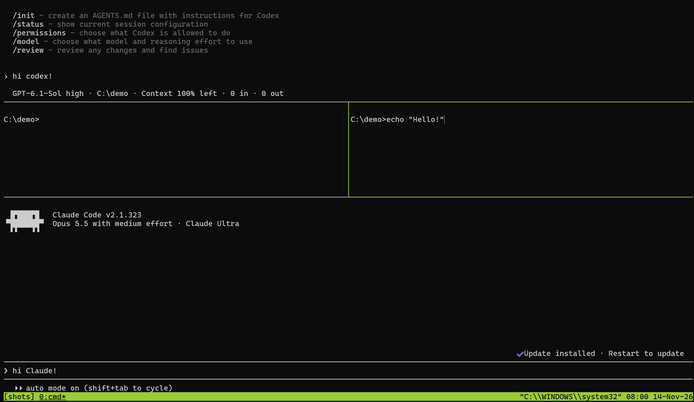
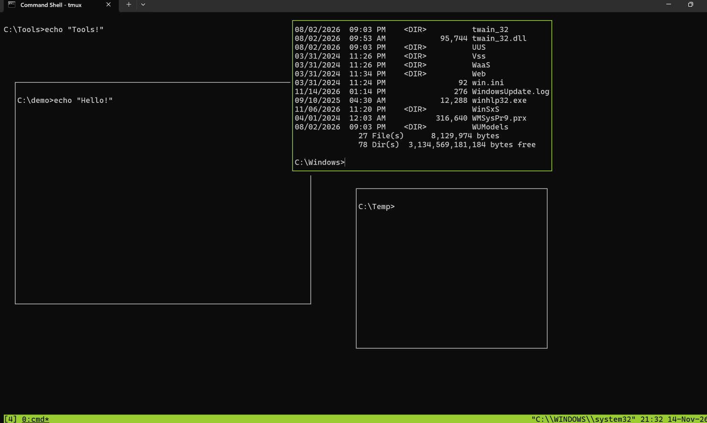
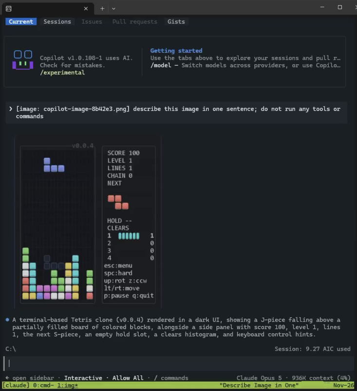

# wtmux

*wtmux - tmux for Windows by Elias Bachaalany.*

**tmux, native on Windows.** The real tmux: its own C sources, built with MSVC. No Cygwin,
MSYS or WSL. One self-contained `tmux.exe` for Windows 10 1809 and later, on x64, x86 and
ARM64. Your `tmux.conf` works. `tmux -V` prints tmux's version as tmux does; `tmux -V -V`
prints this build's banner.

<table>
  <tr>
    <td width="33%"></td>
    <td width="33%"></td>
    <td width="33%"></td>
  </tr>
  <tr>
    <td align="center">Codex, cmd and Claude Code in split panes</td>
    <td align="center">Floating panes (Ctrl+drag with the mouse)</td>
    <td align="center">Images in a pane: GitHub Copilot CLI</td>
  </tr>
</table>

## Install

Download `wtmux-<version>-windows-<arch>.zip` from Releases, extract it, and put the folder
on your `PATH`. To use `wtmux-service`, extract it where only administrators can change
files, such as `C:\Program Files\wtmux`, and run `wtmux-service install` from an elevated
prompt.

Each zip is complete; nothing else needs installing:

| File | What it is |
|---|---|
| `tmux.exe` | tmux; libevent, utf8proc, libpng, zlib and the C runtime are built in |
| `wtmux-service.exe` | the optional session service |
| `conpty.dll`, `<arch>\OpenConsole.exe` | Microsoft's ConPTY package, signed by Microsoft; without them tmux uses the console host built into Windows |
| `COPYING`, `THIRD-PARTY.txt`, `README.md` | tmux's licence, the licences of everything bundled, this file |

`SHA256SUMS.txt` in the same release lists each zip's checksum; compare it with
`Get-FileHash wtmux-<version>-windows-<arch>.zip`. `tmux -V -V`, `wtmux-service version`
and the files' properties (Details) show which release you have.

## Only in wtmux

- **`wtmux-service`**: a Windows service that starts your tmux session on your own desktop,
  even when you ask over SSH. GUI programs show up, and your clipboard, mapped drives and
  network logon are there.
- **`tmux -H user@host`**: attach to tmux on another machine (Windows or Unix) through ssh.
- **`tmux -H tmux://host`**: attach without SSH. TLS, a pinned host key, Windows logon
  (Kerberos) or a TPM-backed key. Off until an administrator turns it on.
- **Byte-exact panes on every Windows**: ships Microsoft's current console host
  (OpenConsole), so Windows 10 behaves like Windows 11. Falls back to the system one.
- **Sharing with other Windows users**: `server-access -a user`, identified per client by
  Windows account.
- **All of tmux**: control mode, images (sixel and kitty), formats, hooks and copy mode
  exactly as upstream, because it is upstream's code.

## Other options on Windows

| | **wtmux** | [tmux-windows](https://github.com/arndawg/tmux-windows) | [psmux](https://github.com/psmux/psmux) |
|---|---|---|---|
| What it is | tmux's C sources + Windows layer | tmux's C sources + Windows layer | new implementation in Rust |
| tmux version | upstream master (next-3.9), synced regularly | 3.6a | own (tmux-compatible) |
| Control mode (`-C`) | yes | no (per its README) | yes |
| Pane console host | bundled OpenConsole, or the system's | system | system |
| Desktop sessions from SSH (service) | `wtmux-service` | — | no |
| Remote attach | over ssh (`-H`) and TLS (`tmux://`) | — | no (loopback only) |
| Other Windows users on one server | yes | — | — |
| Images (sixel, kitty) | yes | — | — |
| Architectures | x64, x86, ARM64 | x64 | x64, x86, ARM64 |
| Signed binaries | not yet | — | yes |
| Install | release zip | winget, zip | winget, scoop, choco, cargo, zip |
| Licence | ISC (tmux) | ISC | MIT |

— : not documented by the project. Corrections are welcome as issues.

New to it? [TUTORIAL.md](TUTORIAL.md) walks through a first session, configuration, SSH and
`tmux -H`, `wtmux-service`, `tmux://` and sharing a session with another user. Windows issues
go here; tmux itself is [upstream](https://github.com/tmux/tmux) and documented in `tmux.1`.

## Requirements

- Windows 10 1809 (build 17763) or later, x64, x86 or ARM64. Older builds
  refuse to start with a clear message.
- Visual Studio 2022 or later with the C++ workload (and the ARM64 tools for ARM64),
  CMake 3.20 or later, Ninja and vcpkg, as included with Visual Studio (its
  developer prompt sets `VCPKG_ROOT`; a separate vcpkg clone works too).
- Network access at the first configure, for vcpkg to build libevent and
  utf8proc (`vcpkg.json`; later builds use its binary cache).
- Optional: network access to a NuGet source at configure time, for the
  bundled ConPTY (below). Without it the build uses the system's ConPTY.

## Building

From a Visual Studio developer prompt:

~~~powershell
cmake --preset msvc-release
cmake --build --preset msvc-release
~~~

The executable is `out\build\msvc-release\tmux.exe`, with `conpty.dll` and
`<arch>\OpenConsole.exe` beside it when the ConPTY package is bundled. Other
presets: `msvc-debug`, `msvc-release-inbox` (system ConPTY only),
`msvc-x86-release` (from an x86 developer prompt) and `msvc-arm64-release`
(from an amd64_arm64 developer prompt).

Build options:

| Option | Default | Effect |
|---|---|---|
| `TMUX_WIN32_CONPTY` | `auto` | `bundled` ships `conpty.dll` and `OpenConsole.exe` from the `Microsoft.Windows.Console.ConPTY` package beside `tmux.exe` and prefers them at run time, falling back to the system ConPTY; `auto` bundles when the package is available; `inbox` uses only the system ConPTY. |
| `TMUX_WIN32_CONPTY_FETCH` | `ON` | Download the pinned package at configure time when it is missing. Its SHA-256 is pinned and every binary must carry a valid Microsoft signature. |
| `TMUX_WIN32_CONPTY_SOURCE` | | NuGet v3 service index to download from; by default the enabled https sources of the user's `NuGet.Config`, else nuget.org. |
| `TMUX_WIN32_CONPTY_PACKAGE` | build directory | An already extracted package, for offline builds. |
| `TMUX_WIN32_IMAGES` | `ON` | Image support (sixel and kitty), as `--enable-images` on Unix. |
| `TMUX_WIN32_MIN_BUILD` | `17763` | Raise the minimum Windows build; newer facilities are used at run time when present either way. |

libevent and utf8proc are installed by vcpkg in manifest mode from `vcpkg.json`,
which pins the vcpkg baseline and the versions (libevent 2.1.12, utf8proc
2.10.0). The presets use vcpkg's toolchain file and a static triplet
(`x64-windows-static`, `x86-windows-static`, `arm64-windows-static`), so
`tmux.exe` has no DLL dependencies besides the optional ConPTY.

## Running

Configuration files are read as on Unix, with `%ProgramData%\tmux\tmux.conf`
in place of `/etc/tmux.conf` and `%USERPROFILE%` as `~`. Files may use LF or
CRLF line endings and may start with a UTF-8 byte order mark.

Environment variables of the client that starts the server:

| Variable | Effect |
|---|---|
| `TMUX_WINDOWS_CONPTY=inbox\|package\|auto` | Override the build's ConPTY choice. |
| `TMUX_WINDOWS_CONPTY_DLL=<path>` | Use a `conpty.dll` other than the one beside `tmux.exe`. |
| `TMUX_WINDOWS_PANE=pipe` | In a pane's environment (`new -e ...`): connect the program with plain pipes instead of a console, so its bytes arrive exactly as through a Unix pty. For programs that write terminal output without needing a console. |
| `TMUX_WINDOWS_CODEPAGE=system\|<number>` | In a pane's environment: the console code page for its programs instead of UTF-8. |

### Images

Programs in a pane can show sixel images, for example `img2sixel` or PowerShell's
`ConvertTo-Sixel`, in a terminal that supports them, such as Windows Terminal 1.22 or
later. Nothing needs to be configured. tmux asks the terminal whether it supports sixel and
how large its cells are, and answers the same questions for the programs in its panes. In a
terminal without sixel, tmux draws images with block characters instead. Images a program
places inside a synchronized update (mode 2026), as GitHub Copilot CLI does, are drawn when
the update ends, after its text.

Kitty graphics work the same way in a terminal that supports them (WezTerm, for example; not
Windows Terminal): tmux asks the terminal, and draws a program's kitty images, PNG ones
included, as kitty images there and as sixel or block characters elsewhere. A program that asks
tmux itself whether kitty graphics work does not get the answer in a pane: the pseudoconsole's
input drops it.

Images need the bundled ConPTY. The system's console host removes sixel and kitty images from a
pane's output, does not answer a program's questions about them, and does not pass them on to
the terminal, so with `TMUX_WINDOWS_CONPTY=inbox`, or in a plain console window, there are no
images.

## Remote attach (tmux -H)

`tmux -H [user@]host[:port] [flags] [command]` runs the same command with the
tmux on another machine (Windows or Unix) through the system's `ssh`, with a
terminal when the command attaches: `tmux -H host attach -t work`. Nothing
listens on the network for it; authentication, logging and policy are sshd's.
`-H` is one of the global flags; the others and the command go to the remote
tmux. On Windows only (the Unix build is upstream's, where `ssh -t host tmux`
does the same).

- Arguments that every shell passes unchanged are sent as they are. Others are
  quoted for the remote login shell: single quotes for a POSIX shell; for a
  Windows host (cmd.exe or PowerShell), a PowerShell script passed with
  `-EncodedCommand`, which starts tmux with an exact command line. The shell's
  family is asked once (`echo $env:OS %OS%`) and kept in
  `%LOCALAPPDATA%\tmux\remote-hosts`.
- `new-session` on a Windows host that runs `wtmux-service` goes to the user's
  desktop session (see below) when the request is simple (`-L`, `-d`, `-s` and
  a command) and the user is logged on there; tmux says where it went.
  Otherwise, or with `TMUX_REMOTE_DESKTOP=0`, it starts as over plain SSH.

| Variable | Effect |
|---|---|
| `TMUX_SSH_COMMAND` | The ssh command line, as git's `GIT_SSH_COMMAND` (default `ssh`). |
| `TMUX_REMOTE_SHELL=windows\|posix` | The remote shell's family, instead of asking. |
| `TMUX_REMOTE_TMUX` | The remote tmux program (default `tmux`, found on the remote `PATH`). |
| `TMUX_REMOTE_DESKTOP=0` | Do not start new sessions through the remote `wtmux-service`. |

### Without SSH: tmux -H tmux://host

When a Windows host has no SSH server, its `wtmux-service` (below) can take
remote clients itself. A destination starting with `tmux://` selects it; the
client is Windows only.

~~~
wtmux-service listen [-a address] [-p port] [-auth keys|windows|both] [-no-ntlm]   (host, elevated)
wtmux-service listen off | fingerprint                                             (host)
tmux -H tmux://[user@]host[:port] [flags] [command]                               (client)
wtmux-service keygen | pubkey                                                      (client)
~~~

- Nothing listens until an administrator runs `listen`; then `127.0.0.1` port
  7380 unless `-a` gives another address. The firewall is never opened; for an
  address other than loopback, `listen` prints the `netsh` command to do it.
- TLS through Schannel: TLS 1.3 where the system has it, else TLS 1.2 with
  ECDHE and AES-GCM; other suites are refused. The host key is a self-signed
  ECDSA P-256 certificate made by the first `listen`, kept non-exportable in
  the machine's store; `wtmux-service fingerprint` shows it. The client pins it
  in `%LOCALAPPDATA%\tmux\known_hosts`: the first time it shows the
  fingerprint and asks (only at a console); a different key later is a hard
  error, as with ssh.
- Logons, inside TLS:
  - Windows accounts (Negotiate). Without `user@`, the client's own account:
    Kerberos in a domain, without a password. With `user@`, the password is
    asked for (or read from standard input when it is not a console). The
    logon is bound to the TLS connection, so it cannot be relayed;
    `-no-ntlm` accepts Kerberos only.
  - Keys. `wtmux-service keygen` on the client makes a key for the current
    user (non-exportable, in the TPM when there is one) and prints its line;
    `pubkey` prints it again. Add the line to
    `%USERPROFILE%\.tmux\authorized_keys` of the account on the host; the
    file and its directory must not be changeable by other users (as sshd's
    `StrictModes`). The logon has no password, so, as with an SSH key, the
    account's network credentials are not available in it. Making or using a
    key needs a logon with a password (a desktop session, not an SSH key
    logon), since Windows protects the key with it.
  - The client tries its key first, then Windows; `TMUX_REMOTE_AUTH=key` or
    `windows` picks one. Three attempts per connection.
- After the logon the service starts `tmux.exe` as that user (in the user's
  desktop session when there is one) to connect to the user's server as a
  local client does. The server's own rules apply as to a local user:
  `server-access`, `-S` for another user's socket, read-only clients. Starting
  a server (`new-session` when none runs) needs the user to be logged on there,
  as `wtmux-service new`; it then runs on the user's desktop.
- The server is on another machine, and is treated as such: the client sends
  its terminal and locale variables (`TERM`, `COLORTERM`, `LANG`, `LC_*`), no
  other environment and no working directory; the server sees the helper's
  process, not the client's; it may use the client's standard input and
  output (`load-buffer -`, `save-buffer -`) but not open files on the client
  machine, nor run programs there (`lock-command` is not run, `detach-client
  -E` only detaches); the client's clipboard is not offered to it.
- Limits: a connection must log on within 120 seconds (`LoginGraceSeconds` in
  the service's `Parameters` registry key changes it); after three failed
  logons from one address, or for one account, the next must wait 1, 2, 4
  seconds and so on, up to 5 minutes; at most 64 connections, 8 from one
  address. Logons, failures and disconnections are logged as the service's
  requests are.
- `listen off` closes the port; `uninstall` removes the settings and the host
  key.

| Variable | Effect |
|---|---|
| `TMUX_REMOTE_KNOWN_HOSTS` | The known hosts file, instead of `%LOCALAPPDATA%\tmux\known_hosts`. |
| `TMUX_REMOTE_AUTH=key\|windows` | Log on only with the key, or only with a Windows account. |

## Session service (wtmux-service)

`wtmux-service` is optional. You need it only for the cases marked here:

| You want to | Service needed? |
|---|---|
| Run tmux at the machine | no |
| SSH in and use console programs | no: run `tmux` over SSH |
| SSH in and have your session on your own desktop (graphical programs shown, mapped drives, network logon, clipboard) | **yes**: `wtmux-service new` |
| Reach a Windows machine that has no SSH server | **yes**: `wtmux-service listen` and `tmux -H tmux://host` (above) |
| Let another Windows user attach to your session | no: `server-access` (below) |

A tmux server runs in the Windows session of the client that starts it. Over
SSH, or from a service, that is session 0, which has no visible desktop: the
programs in its panes run, but a graphical one is never seen, and the user's
network credentials, clipboard and mapped drives are not there.
`wtmux-service.exe`, installed beside `tmux.exe`, is a Windows service that
starts tmux inside a logged-on user's own session (`winsta0\default`), as if
the user had started it at the keyboard. Attaching needs nothing from it: the
user's socket is the same in every session, so `tmux attach` over SSH reaches
the server it started.

~~~
wtmux-service install | uninstall           (elevated)
wtmux-service version                       (also -V)
wtmux-service ls
wtmux-service new [-w] [-i session-id] [-L socket-name] [-s session-name] [-u user] [--] [command ...]
~~~

- `version` prints this program's banner, then the service's state: not
  installed, installed and stopped, or running, with the running service's
  version and path.
- `install` needs a folder only administrators can change. The service runs as
  SYSTEM and starts the programs in its folder, so a folder other users can
  write to would let them run code as SYSTEM, or as you. A folder under
  Program Files is one. Refused elsewhere, `install` names who else may change
  the folder, and prints the commands that fix it: copy the folder under
  Program Files with `robocopy`, or lock this folder down with `icacls`. Run
  them from an elevated prompt.

- `ls` lists the logged-on users' Windows sessions (active, locked or
  disconnected) and the tmux sessions of the caller's user (an
  administrator's: of every user).
- `new` starts a tmux session (`new-session -d`) in the user's active session,
  or the one `-i` names; `-w` also opens a terminal attached to it on that
  desktop (Windows Terminal if the user has it, else a console window). The
  reply gives the socket path and the `attach` command.
- Anyone may start a session for themselves; an elevated administrator for any
  logged-on user, and is then let into that server (`server-access -a`).
  A user who is not logged on is refused: there is no desktop to start on.
  A socket whose server already runs in another session (one started over
  SSH) is refused too, since it would get the session.
- While a session is locked or disconnected its windows exist but are not
  drawn; they appear when the user returns. Programs run as the user, not
  elevated.

The service runs as LocalSystem and listens on the local pipe
`\\.\pipe\wtmux-service` (owned by SYSTEM, which clients check; remote pipe
clients are rejected), so remote use is through SSH, unless an administrator
turns on its network listener (`tmux -H tmux://`, above). It identifies callers
from the pipe without acting as them, refuses to install from a directory
that others than administrators may change, and logs every request to
`%ProgramData%\wtmux-service\service.log` and the Application event log.

## Sharing a session with another user

This is tmux's own `server-access` command. Each user has their own tmux
server, and only its owner can attach until the owner lets someone else in.
No service is needed.

1. As the owner (`user1`), inside tmux, allow the other user:

   ~~~
   tmux server-access -a user2        # read-write
   tmux server-access -a -r user2     # or read-only
   ~~~

   This adds `user2` to the access lists of `user1`'s socket and its identity
   pipe. It lasts as long as that server runs. To allow `user2` every time the
   server starts, put the same `server-access` line in `user1`'s `tmux.conf`.
2. Still as `user1`, print the socket path to give to `user2`:

   ~~~
   tmux display -p "#{socket_path}"
   ~~~

   It is in `user1`'s temporary folder, for example
   `C:\Users\user1\AppData\Local\Temp\tmux-<id>\default`.
3. As `user2`, locally or over SSH, attach to it:

   ~~~
   tmux -S "C:\Users\user1\AppData\Local\Temp\tmux-<id>\default" attach -t sess1
   ~~~

`tmux server-access -d user2` removes the permission, and `server-access -l`
lists who is allowed. Allow only users you trust, even read-only: a read-only
client still sees everything in the session. The server identifies each client by its Windows account;
Windows groups are not supported. An elevated administrator who starts a
session for a user with `wtmux-service new -u user` is let into that server
without this step.

## Differences from tmux on Unix

### Windows' own console host (system ConPTY)

Windows 10's own console host (10.0.19041) is older than the one in the
ConPTY package: used through the system ConPTY, it keeps programs' mouse
requests, drops OSC 7 and 9;9 reports (so `#{pane_current_path}` comes only from
the process), breaks a wrapped line in two when it re-renders it, does not
pass some keys (NUL, the extended Tab forms; Meta with `]`, `[`, `O`,
Backspace and Escape; Home and End re-encoded) and gives a program reading the
console C-z as end of input. tmux recognises that console at run time and sends
Meta with `P`, `X`, `^` and `_` as bytes there. The bundled ConPTY, the default, has
none of these, on Windows 10 too.

Windows 11 22H2's own console host (10.0.22621) is between the two: it drops
NUL (C-Space), holds an Escape typed on its own until more input comes, and
writes nothing more once a program has started, so with the system ConPTY a
program that writes nothing keeps the shell's window name (automatic-rename
looks again only when a pane writes, as on Unix, and a command runs under
`cmd.exe /c`). Both it and Windows 10's console host give a program reading
the console a C-z that starts a read as a read of no bytes; tmux's client takes
that as C-z, so a C-z typed in a console window reaches tmux (C-b C-z is
`suspend-client`) rather than ending the client.

### Panes

| Area | Unix | Windows |
|---|---|---|
| Output | The program's bytes reach tmux unchanged. | With the bundled ConPTY, unchanged. With the system ConPTY, the console host re-renders output (splits SGR, adds `id=` to OSC 8 links, turns titles into OSC 0). `TMUX_WINDOWS_PANE=pipe` is exact with either. |
| Mouse requests | Every program's requests reach tmux. | With the bundled ConPTY, the same. With the system ConPTY, only from programs that enable VT input. |
| Keys sent to programs | As encoded. | The same for programs reading VT input; Meta with `P` `X` `]` `^` `_` is sent as a key event, since the console would start a control string. |
| Console code page | | UTF-8 (65001), so programs writing UTF-8 bytes need no `chcp`; programs using the wide console API are unaffected. `TMUX_WINDOWS_CODEPAGE=system` (or a code page number) in the pane's environment gives the system's instead, for programs that expect it. |
| `#{pane_tty}` | `/dev/pts/N` | `conpty-<server pid>-<pane id>`; a client started in the pane is named by it. |
| Ending a pane | SIGHUP; programs ignoring it survive. | The pane's Job Object is terminated with it, including background programs started from the pane. |

### Information tmux reads from a pane

| Format | Unix | Windows |
|---|---|---|
| `#{pane_current_path}` | The foreground process's directory. | The same, read from the foreground process (64-bit or 32-bit). PowerShell, MSYS and Cygwin programs keep their own directory, so for them the pane's last OSC 9;9 or OSC 7 report is used (else the start directory): panes get a `PROMPT_COMMAND` that reports for bash, and `PROMPT=$e]9;9;$P$e\$P$G` for cmd.exe, unless already set; PowerShell needs the prompt hook below. An OSC 7 report naming another computer (a shell over ssh) is ignored, and a UNC path is taken without checking it, so a report never makes tmux wait for the network. |
| `#{pane_current_command}`, automatic names | The foreground process group. | The newest process in the pane's Job Object, without `.exe`. |
| `#{pane_pid}`, `#{pid}` | Unix process IDs. | Windows process IDs. |

A Microsoft Store-packaged PowerShell started through `cmd.exe` can leave the
pane's Job Object. Then the command name and directory describe the wrapping
`cmd.exe`, and ending the job does not terminate the escaped process. Launch
PowerShell directly (an executable and separate arguments, rather than one shell
command string), or make it `default-shell`, to keep it in the pane's job.

PowerShell prompt hook for `pane_current_path`:

~~~powershell
# PowerShell profile prompt {
    $loc = $executionContext.SessionState.Path.CurrentLocation
    $out = ""
    if ($loc.Provider.Name -eq "FileSystem") { $out += "$([char]27)]9;9;`"$($loc.ProviderPath)`"$([char]27)\" }
    $out + "PS $loc$('>' * ($nestedPromptLevel + 1)) "
}
~~~

### Shells and commands

| Area | Unix | Windows |
|---|---|---|
| Default shell | `$SHELL`, else `/bin/sh` | `$SHELL` when it is a Windows path, else `%ComSpec%` (cmd.exe). |
| Command lines | `sh -c "..."` | Each shell's own convention: `cmd.exe /d /s /c "..."`, `pwsh -NoProfile -Command ...`, `-c` for POSIX shells, `-l` for login shells, Cygwin quoting for Cygwin and MSYS programs. |
| `run-shell`, `if-shell`, `#()`, `pipe-pane`, `copy-pipe`, `lock-command` | `/bin/sh -c` | The `default-shell` (the client's shell for `lock-command`), since there is no `/bin/sh`: cmd.exe unless set, so a configuration's commands have one syntax. |
| `tmux -c command` | Executes the shell. | Runs it and returns its exit status. |
| Paths in tmux commands | | Backslash is tmux's escape character: single-quote Windows paths or use `/`. |
| Default editor | `vi` | `notepad.exe` |

### Clients and the server

| Area | Unix | Windows |
|---|---|---|
| Socket | `$TMUX_TMPDIR/tmux-UID/name` | The same: an AF_UNIX socket at `$TMUX_TMPDIR` (default the user's temporary directory) `/tmux-<uid>/<name>`, or the path `-S` gives, in a directory open only to its user; the socket file is owned by the user and open only to it. A client first asks the server's identity pipe (`\\.\pipe\tmux-<hash of the path>`, same owner and access) for a one-time nonce, which tells the server its account, and sends it on the socket. |
| `server-access` | Other users and groups by socket permission. | Other Windows users: `server-access -a user` adds the account to the socket file's and the identity pipe's access lists, and the server identifies each client by its account (the client connects to the pipe at identification level, so the server cannot act as it). The other user names the server by its socket path with `-S`, as on Unix; a client trusts an identity pipe only with the socket file's owner. Windows groups are not supported. uids are the accounts' RIDs. |
| `suspend-client` | Stops the client. | No job control: the client resumes at once. |
| `detach-client -P` | Sends SIGHUP to the parent. | Ends the parent process. |
| `lock-command` default | `lock -np` | Locks the Windows session. |
| Outer terminal | terminfo for `$TERM` | A built-in description of a modern VT terminal (Windows Terminal, the console host), with the keys of `screen` and `tmux` when `$TERM` names them (a client inside a pane), styled underlines, overline and the OSC 9;4 progress bar (not underline colour, which both consoles misread). 256 colours and RGB (both consoles have them) and left/right margins are always on. The usual queries add the rest: clipboard (OSC 52 sets the Windows clipboard in both; neither answers a request to read it, so a client on the desktop answers from the Windows clipboard for `refresh-client -l` and panes, and a client under SSH leaves it to the terminal at the other end), cursor style and colour, focus; Windows Terminal also sixel and synchronized updates. `terminal-overrides` and `terminal-features` apply as usual. |
| Character set | The locale's. | Always UTF-8. |
| A 0xff byte in a sourced file | Read as the end of the file where `char` is signed, so `source-file` stops there. | Read as a byte. |
| Regular expressions | The C library's (multibyte-aware with glibc). | OpenBSD's, as tmux on OpenBSD: a byte-oriented POSIX implementation. |
| Signals | `kill -USR1` recreates the socket, `-USR2` toggles logging. | The named events `Local\tmux-<server pid>-USR1` and `-USR2` (`#{pid}`), for example `[Threading.EventWaitHandle]::OpenExisting("tmux-$pid-USR2").Set()` in PowerShell; the log goes to the server's working directory. Ctrl+C, Ctrl+Break and console close, logoff and shutdown are handled like SIGINT and SIGTERM. |

## Source layout

| Path | Contents |
|---|---|
| `win32/` | The Windows layer of `tmux.exe`: IPC, processes and Job Objects, ConPTY panes, console client, signals, built-in terminal description, CRT and UTF-8 compatibility, manifest. `win32/win32-main.c` is the entry point. `win32/include/` holds empty stand-ins for POSIX headers. `win32/service/` is `wtmux-service.exe`. |
| `platform/` | A small library: pty abstraction, Windows argv and shell quoting, discovery framing. |
| `compat/regex/` | OpenBSD's POSIX regular expressions (`regex.h`), which Windows lacks, adapted as the other OpenBSD sources in `compat/`. |
| `cmake/` | The Windows build: `Windows.cmake` (the `tmux` target, its options and the ConPTY package), `Sources.cmake` (tmux's source list) and `Version.cmake` (tmux's version). |
| `vcpkg.json` | The Windows build's libevent and utf8proc, for vcpkg. |

## About this tree

- **It builds for Windows only**, with Visual Studio (MSVC). On other systems,
  build tmux itself.
- **Everything the build compiles is in the tree**, so no parser generator or
  other tool runs at build time:
  - `cmd-parse.c`, tmux's command parser, as produced by GNU Bison 3.8.2;
  - `win32/tmux-keyc.h`, tmux's special key codes as macros: MSVC enumeration
    constants are `int`, too narrow for tmux's 64-bit key codes, so for MSVC
    `tmux.h` includes these instead of its enum;
  - `win32/win32-terminfo-ncurses.h`, the built-in descriptions of the
    terminals tmux emulates (below);
  - `cmake/Sources.cmake` and `cmake/Version.cmake`, tmux's source list and
    version.

## Third-party code

| Component | Origin | Licence |
|---|---|---|
| The initial Windows layer in `win32/` and `osdep-windows.c` | [arndawg/tmux-windows](https://github.com/arndawg/tmux-windows) | ISC, as tmux |
| `compat/regex/` | OpenBSD `lib/libc/regex` | BSD-3-Clause, per-file notices |
| `cmd-parse.c` | Generated by GNU Bison 3.8.2 from tmux's `cmd-parse.y` | ISC, as tmux; Bison's parser skeleton under GPL-3.0-or-later with the Bison exception (notices in the file) |
| `win32/win32-terminfo-ncurses.h` | The `screen`, `screen-256color`, `tmux` and `tmux-256color` terminfo entries of ncurses 6.4.20240113, as data | MIT-style (X11), as ncurses (notice in the file) |
| libevent | 2.1.12, installed by vcpkg at build time and not part of the sources | BSD-3-Clause |
| utf8proc | 2.10.0, installed by vcpkg at build time and not part of the sources | MIT |
| libpng | 1.6.51, installed by vcpkg at build time and not part of the sources (kitty PNG images) | libpng-2.0 |
| zlib | 1.3.1, installed by vcpkg at build time and not part of the sources (libpng, compressed kitty images) | Zlib |
| ConPTY (bundled builds) | `Microsoft.Windows.Console.ConPTY` 1.25.260930003 from NuGet, downloaded at build time and not part of the sources | MIT |

Per-file notices apply as everywhere in tmux; see `COPYING`.